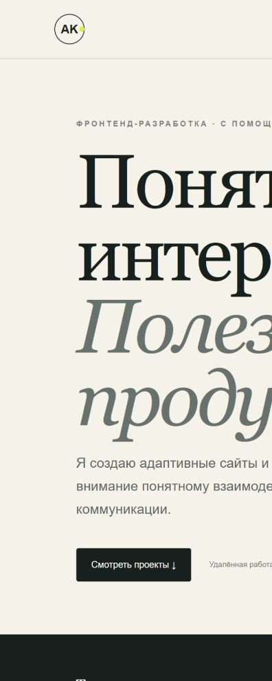

# Frontend portfolio

Static bilingual portfolio presenting three original demonstration projects: FitCoach, SmartBooking and Northstar MiniCRM. All work is self-directed and AI-assisted; no commercial results or clients are claimed.

## Included work

- **FitCoach:** responsive fitness landing page and validated enquiry flow.
- **SmartBooking:** duration-aware studio calendar and booking lifecycle.
- **Northstar MiniCRM:** opportunity pipeline, contacts and follow-up tasks.

## Run locally

Serve the `dist` directory with any static HTTP server and open its root URL. The page has no build step or external runtime dependencies. Language preference is saved in the browser.

The contact block uses the user-approved email `Kopytovdv1999@gmail.com`. Project screenshots and copied project notes are bundled in `dist`, making the directory suitable for static hosting after final link review.

## Preview attribution — 2026-11-04
Author credits are baked into82previewassets while preserving their published paths, formats and dimensions. Portfolio pages include author metadata and a localized usage page. Existing1685navigation/projectlinks were verified unchanged; localtargetvalidation passed. Browser checks at1440/768/390px verified no horizontaloverflow, filtering, mobilemenu andusage-language navigation. Independentread-onlyreview found no substantive remaining defects.
This is copying deterrence and attribution, not DRM. Publicdemo code and previous Gitcommits remain accessible. Existingthirdparty and projectlicenses remain in force. Cleanpreviewbackups are outside the publishedtree at D:\Projects\Работа\.review\portfolio-original-previews. Reapply watermarks when replacingpreviewassets.
