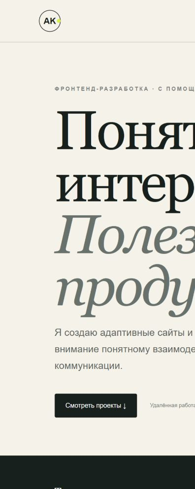

# Frontend portfolio

Static bilingual portfolio presenting three original demonstration projects: FitCoach, SmartBooking and Northstar MiniCRM. All work is self-directed and AI-assisted; no commercial results or clients are claimed.

## Included work

- **FitCoach:** responsive fitness landing page and validated enquiry flow.
- **SmartBooking:** duration-aware studio calendar and booking lifecycle.
- **Northstar MiniCRM:** opportunity pipeline, contacts and follow-up tasks.

## Run locally

Serve the `dist` directory with any static HTTP server and open its root URL. The page has no build step or external runtime dependencies. Language preference is saved in the browser.

The contact block uses the user-approved email `Kopytovdv1999@gmail.com`. Project screenshots and copied project notes are bundled in `dist`, making the directory suitable for static hosting after final link review.
